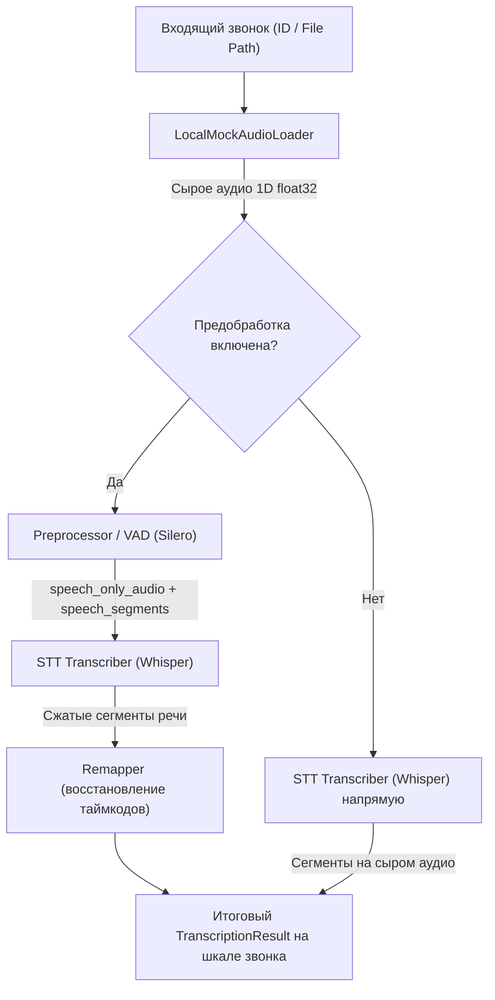

# Оркестратор обработки звонков (`orchestrator/`)

Пакет `orchestrator/` реализует сквозной конвейер обработки телефонных звонков на основе слабо связанных изолированных компонентов («Чёрные ящики»).

---

## 1. Архитектурная концепция («Чёрные ящики»)

1. **Разделение ответственности модулей:**
   - Модули `audio_preprocessing` (конвертация, шумоподавление, VAD) и `stt` (транскрибация) являются независимыми «чёрными ящиками».
   - Рабочая реализация STT не импортирует `audio_preprocessing` или `vad`; предобработка и VAD не импортируют STT. Предобработка использует VAD через его публичную фабрику.
   - Тесты, генератор примеров и документация могут ссылаться на аудиофайлы и контекст соседних модулей.
2. **Транскрибатор не знает о предобработке:**
   - Интерфейс `BaseTranscriber` принимает стандартный аудиопоток (1D float32 массив или путь к файлу).
   - Если предобработка включена, оркестратор передает в транскрибатор только склеенные участки речи (`speech_only_audio`).
   - Если предобработка выключена, оркестратор передает исходное сырое аудио.
   - Сам `stt` не знает и не должен знать, было ли аудио предварительно очищено или сегментировано.
3. **Восстановление таймкодов на стороне оркестратора:**
   - Пересчет временных меток (`remap_transcription_result`) вынесен из модуля предобработки в оркестратор, так как именно оркестратор связывает хронометраж исходного звонка, границы пауз VAD и сегменты транскрипции.
   - Пересчитываются границы сегментов и отдельных слов. Строки `utterances` учитывают паузы исходной записи.
4. **Совместимые интерфейсы In-Memory и REST API:**
   - Адаптеры `RestPreprocessorClient` и `RestTranscriberClient` позволяют использовать `CallProcessingPipeline` с локальными Python-компонентами и HTTP-сервисами.
   - REST-клиенты передают массивы в WAV PCM_16, что добавляет квантование относительно float32 в памяти. Клиент предобработки также приводит полученное аудио к моно 16 кГц. Побитовая идентичность результатов двух режимов не гарантируется.
   - Таймаут HTTP-запроса к STT настраивается через `RestTranscriberClient(timeout=...)`, по умолчанию 600 секунд.
   - В обоих режимах настраивайте загрузчик и выход предобработки на 16 кГц для массива, передаваемого в STT. HTTP-сервисы дополнительно применяют ограничения размера, длительности и числа одновременных запросов.

---

## 2. Диаграмма потока данных (Data Flow)



---

## 3. Структура модуля

```text
orchestrator/
├── __init__.py           # Публичные экспорты модуля
├── interfaces.py         # Базовый интерфейс BaseAudioLoader и протоколы сервисов
├── loaders.py            # LocalMockAudioLoader (эмуляция CRM / локального хранилища)
├── rest_clients.py       # HTTP REST-клиенты RestPreprocessorClient и RestTranscriberClient
├── pipeline.py           # CallProcessingPipeline + утилита remap_transcription_result
├── demo.py               # Консольная демонстрация двух режимов для заказчика/техлида
├── README.md             # Документация модуля
└── tests/
    ├── __init__.py
    └── test_orchestrator.py # Тесты изоляции, in-memory конвейера и REST API
```

---

## 4. Примеры использования

Установите зависимости из корневого `requirements.txt` и выполняйте команды и Python-примеры из корня репозитория.

### 4.1. Режим In-Memory (быстрый локальный запуск)

```python
from audio_preprocessing import get_audio_pipeline
from orchestrator import CallProcessingPipeline, LocalMockAudioLoader
from stt import TranscriberConfig, get_transcriber

# 1. Инициализация компонентов
loader = LocalMockAudioLoader(base_dir="audio_preprocessing")
preprocessor = get_audio_pipeline()
transcriber = get_transcriber(config=TranscriberConfig())

# 2. Создание и запуск конвейера
pipeline = CallProcessingPipeline(
    audio_loader=loader,
    preprocessor=preprocessor,
    transcriber=transcriber,
    remap_timestamps=True,
)

result = pipeline.run("input_test_call.mp3")
print("Текст:", result.text)
print("Длительность звонка:", result.duration)
```

### 4.2. Режим микросервисов (через HTTP REST API)

Сначала запустите сервисы по инструкциям [предобработки](../audio_preprocessing/README.md) (порт 8002) и [STT](../stt/README.md) (порт 8001). Клиенты отправляют файлы через multipart-загрузку; общий том для этого примера не требуется. После использования закройте оба клиента методом `close()` или используйте их как контекстные менеджеры.

```python
from orchestrator import (
    CallProcessingPipeline,
    LocalMockAudioLoader,
    RestPreprocessorClient,
    RestTranscriberClient,
)

# Клиенты к распределенным FastAPI микросервисам
preprocessor = RestPreprocessorClient(base_url="http://localhost:8002")
transcriber = RestTranscriberClient(base_url="http://localhost:8001")
loader = LocalMockAudioLoader(base_dir="audio_preprocessing")

pipeline = CallProcessingPipeline(
    audio_loader=loader,
    preprocessor=preprocessor,
    transcriber=transcriber,
    remap_timestamps=True,
)

result = pipeline.run("input_test_call.mp3")
```

---

## 5. Запуск демонстрации и тестов

Запуск консольного демо двух режимов:
```bash
python -m orchestrator.demo
```

Запуск полного набора тестов:
```bash
pytest audio_preprocessing/tests/ stt/tests/ orchestrator/tests/ -v
```
